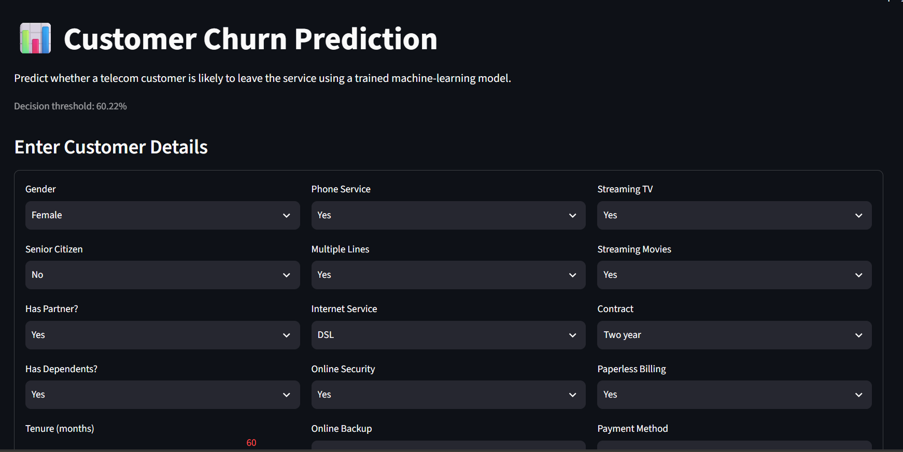
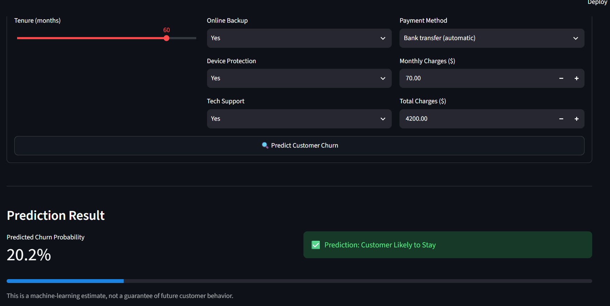

# 📊 Customer Churn Prediction

A machine learning project that predicts whether a telecom customer is likely to leave a service. It uses customer information, service subscriptions, contract details, and billing data to estimate churn probability through an interactive Streamlit web application.

## 🚀 Project Overview

Customer churn is an important business problem because retaining existing customers can be more cost-effective than acquiring new ones. This project uses historical customer data to build a classification model that helps identify customers who may be at risk of leaving.

The application accepts customer details, calculates a churn probability, and displays a prediction based on a tuned decision threshold.

## ✨ Features

- Data cleaning and exploratory data analysis (EDA)
- Numerical and categorical feature preprocessing
- Comparison of Logistic Regression with and without oversampling
- Hyperparameter tuning of Logistic Regression, Random Forest, and Extra Trees
- Decision-threshold selection using training data
- Model evaluation on a held-out test set
- Permutation feature importance
- Saved model and threshold metadata
- Interactive Streamlit web application

## 🛠️ Technologies Used

- **Language:** Python
- **Data analysis:** pandas, NumPy
- **Visualization:** Matplotlib, Seaborn
- **Machine learning:** scikit-learn, imbalanced-learn
- **Model persistence:** joblib
- **Web application:** Streamlit
- **Development:** Jupyter Notebook

## 📂 Project Structure

```text
Customers-Churn-Prediction/
├── app.py
├── Churn.ipynb
├── README.md
├── requirements.txt
├── .gitignore
├── data/
│   └── WA_Fn-UseC_-Telco-Customer-Churn.csv
├── model/
│   ├── best_model.joblib
│   └── model_metadata.joblib
└── screenshots/
    ├── churn_prediction_form_top.png
    └── churn_prediction_result.png
```

## 📊 Dataset

This project uses the Telco Customer Churn dataset, which contains 7,043 customer records and 21 columns, including customer services, contract information, billing details, and churn status.

The target variable is `Churn`, which indicates whether a customer left the service.

## 🤖 Model Development

The notebook performs data validation, cleaning, exploratory analysis, preprocessing, model comparison, and hyperparameter tuning.

Logistic Regression was selected based on its cross-validation ROC-AUC score.

The final model uses a decision threshold selected on training data to balance precision and recall according to the F1-score.

## 📈 Test Set Results

The selected model was evaluated on a held-out test set containing 1,409 records.

| Metric | Test result |
|---|---:|
| Accuracy | 76.79% |
| Precision (Churn class) | 54.89% |
| Recall (Churn class) | 70.59% |
| F1-score (Churn class) | 61.75% |
| ROC-AUC | 84.09% |
| Average Precision | 62.55% |

These results represent the current model and threshold. Performance may vary on other data. Precision and recall reflect different trade-offs, so accuracy alone should not be used to judge the model.

## 🖥️ Application Screenshots

### Customer Input Form



### Prediction Result



## ⚙️ Run the Project Locally

### 1. Clone the repository

```bash
git clone https://github.com/KanakVishnoi/Customers-Churn-Prediction.git
cd Customers-Churn-Prediction
```

Replace `YOUR_GITHUB_REPOSITORY_URL` with your actual GitHub repository URL.

### 2. Create and activate a virtual environment

Windows Command Prompt:

```bat
python -m venv .venv
.venv\Scripts\activate
```

### 3. Install dependencies

```bash
python -m pip install -r requirements.txt
```

### 4. Start the Streamlit application

```bash
streamlit run app.py
```

Open the local URL displayed in the terminal to use the application.

## 🔮 Future Improvements

- Improve churn detection through additional feature engineering and model experimentation.
- Add clearer visual explanations of customer risk factors.
- Improve input validation and customer-service consistency checks.
- Deploy the application online for public access.
- Monitor model performance on new customer data.

## ⚠️ Disclaimer

This application provides machine-learning estimates, not guarantees of future customer behavior. Predictions should support, rather than replace, business judgment.

## 👩‍💻 Author

**Kanak Vishnoi**

B.Tech CSE (AI & ML) Student | Interested in Data Analytics, Machine Learning, and Data Science
